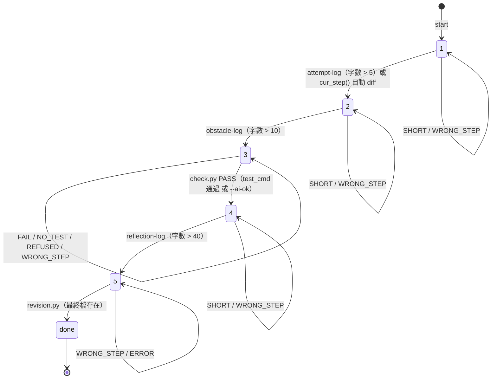

# Step 狀態機

五步驟流程的狀態定義與轉移規則。實作位於 `.research/bin/`（`lib.py` 為核心）。

## 狀態儲存

| 檔案 | 角色 | 內容 |
|---|---|---|
| `.research/step.now` | **目前狀態（唯一真相來源）** | 只有一個值：`1` `2` `3` `4` `5` `done` |
| `.research/step.log` | 狀態變化紀錄（只增不改） | 每次**狀態真的改變**時 append 一行 |

- 讀取目前狀態：一律讀 `step.now`（檔案缺失時才退回 `step.log` 最後一行，僅供相容舊 repo）。
- 更新狀態：呼叫 `lib.set_step(新步驟, 事件, 額外資訊)`；`新步驟 == 目前步驟` 時只更新檔案、**不寫 log**。
- `step.log` 行格式：`<UTC時間戳> step=<新步驟> event=<事件> [額外資訊]`

## 狀態意義

| 狀態 | 名稱 | 說明 |
|---|---|---|
| `1` | 嘗試 | 學生先寫下自己的想法，AI 不介入 |
| `2` | 卡點 | 學生動手後指出具體障礙，AI 仍不給解法 |
| `3` | AI 介入 | 針對卡點提供有限協助 |
| `4` | 比較反思 | 學生比較 AI 協助與自己原本想法 |
| `5` | 修訂掛名 | 最終修訂與說明 |
| `done` | 完成 | 流程結束，不再記錄 |

## 轉移規則

### record.py（記錄原文）

用法：`uv run .research/bin/record.py <資料夾> <預期步驟> <字數下限> <通過後步驟>`（內容由 stdin 讀入）

| 呼叫來源（skill） | 資料夾 | 預期步驟 | 字數下限 | 通過後步驟 |
|---|---|---|---|---|
| `attempt-log` | `.attemptlog` | 1 | 5 | 2 |
| `obstacle-log` | `.obstaclelog` | 2 | 10 | 3 |
| `targeted-response` 動作 A | `.targetedresponse` | 3 | 0 | 3（不變） |
| `reflection-log` | `.reflectionlog` | 4 | 40 | 5 |

判定順序：

1. 目前步驟 ≠ 預期步驟 → 輸出 `WRONG_STEP`，**不改狀態、不寫 log**（原文也不記錄）。
2. 目前步驟符合 → 先存 `<資料夾>/<時間戳>.md`。
3. 字數（去空白後）> 下限 → `set_step(通過後步驟, ...)`，狀態變化才寫 log；輸出 `PASS`。
4. 否則 → 維持原步驟，**不寫 log**；輸出 `SHORT`。

### check.py（Step 3 → 4 的驗證）

僅可在狀態 `3` 執行，否則 `WRONG_STEP`（不改狀態、不寫 log）。

| 條件 | 行為 | 狀態 |
|---|---|---|
| 有 `.research/test_cmd`，測試 exit 0 | `PASS` | 3 → **4**（log `mode=test`） |
| 有 `.research/test_cmd`，測試失敗 | `FAIL`（印最後 15 行） | 維持 3，不寫 log |
| 有 `.research/test_cmd`，卻加 `--ai-ok` | `REFUSED` | 維持 3，不寫 log |
| 無 `test_cmd`，加 `--ai-ok` | `PASS（AI 判定）` | 3 → **4**（log `mode=ai`） |
| 無 `test_cmd`，未加 `--ai-ok` | `NO_TEST` | 維持 3，不寫 log |

### revision.py（Step 5 → done）

用法：`uv run .research/bin/revision.py <最終檔案路徑>`

| 條件 | 行為 | 狀態 |
|---|---|---|
| 目前步驟 ≠ 5 | `WRONG_STEP` | 不改狀態、不寫 log |
| 找不到最終檔案 | `ERROR` | 不改狀態、不寫 log |
| 正常 | 快照 + 計算 3-gram 重疊，寫 `.revisiondiff/` | 5 → **done**（log `revisiondiff_done`） |

### cur_step() 自動 diff 檢查

當目前步驟為 `1` 時，`cur_step()` 會額外執行：

```bash
git diff -- . ':!.devcontainer' ':!.opencode' ':!.research'
```

若 `.devcontainer` / `.opencode` / `.research` 以外的檔案合計變更超過 5 字，就把 diff 內容寫入 `.attemptlog/<時間戳>.md`，並呼叫 `set_step("2", ...)` 進入 Step 2。
此檢查不會在 `record.py`、`check.py`、`revision.py` 內部觸發，避免干擾 skill 的步驟驗證。

### 不觸發轉移的動作

- `targeted-response` 動作 A：在 step 3 記錄 AI 回應，狀態不變（`next=3`），因此不寫 `step.log`；內容存於 `.targetedresponse/`。
- `step.py`：輸出 `STEP=<目前狀態大寫>`；若處於 Step 1 且符合自動 diff 條件，會一併觸發狀態轉移。

## 流程圖



## 要調整時改哪裡

- **狀態定義／轉移核心**：`.research/bin/lib.py` 的 `cur_step()` / `set_step()`。
- **字數下限、預期步驟**：不在腳本內硬編碼，由各 skill 的呼叫參數決定 → 改 `.opencode/skills/*/SKILL.md` 中 `record.py` 的參數。
- **驗證條件**：改 `.research/bin/check.py`（例如 test_cmd 路徑、`--ai-ok` 政策）。
- **紀錄格式**：`step.log` 寫入在 `lib.set_step()`；快照與比對邏輯在 `revision.py`。
- 新增狀態或分支時：同步更新本檔與 `AGENTS.md` 的步驟說明。
